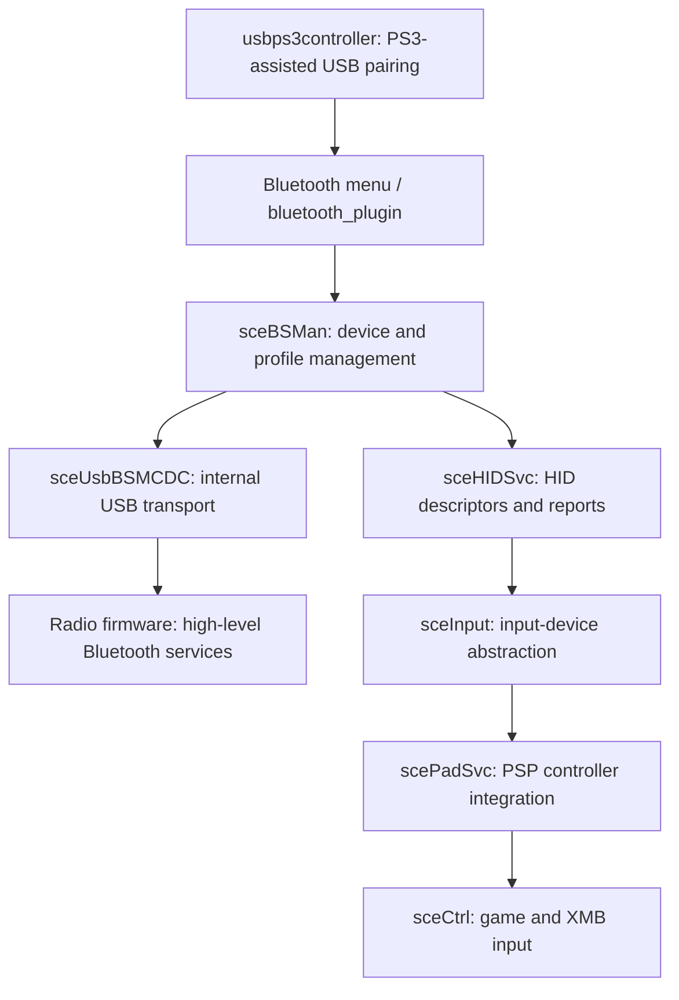

# PSP Go Bluetooth: PSP-side architecture and radio interface

Status: first structured pass over the available PSP-side material. This is not a complete reverse engineering of the radio's firmware and not a working DS4 connection implementation.

## Scope and reproducibility

Inputs: the locally extracted official PSP Go 6.61 update, five user-supplied loaded-code snapshots, the earlier connection logs, and published CSR/BlueZ protocol definitions. The radio's own executable image is not present as an identified input.

The inventory covers 341 extracted files (43,051,381 bytes), including 238 MIPS ELF PRXs. The five captured Bluetooth/input modules total 108,176 bytes of text. The Ghidra analysis generated 776 function files, including import stubs, aliases and imperfect function seeds; that is not a claim of 776 fully understood functions. Literal-assignment analysis identified 45 transaction-call candidates spanning 33 request values. The generated CSV is deliberately marked as candidates rather than a control-flow proof.

`inventory.py` regenerates metadata from private inputs; it does not copy their contents. The published catalogues contain filenames, hashes, offsets, symbols, counts and candidate opcodes, not firmware/decompiler code or user pairing data.

## Architecture

The internal USB host path is different from the external USB peripheral/storage path used to connect the Go to a PC. Plugging the Go into Linux does not by itself expose the internal radio as a Linux Bluetooth adapter.

The active command path is higher-level than ordinary HCI. Connection, discovery and SDP requests are packaged as Sony BSM commands and sent into the module. The inspected PSP connection routine does not itself contain the complete LMP/authentication state machine. That is an architectural finding, not evidence that raw HCI is impossible to expose.

## Internal USB transport

The transport's device-match routine recognizes CSR 0A12:1032/1033 and Sony 054C:043C/04A9. These are IDs of candidate **radio USB devices**, not DS3/DS4 controller IDs. The actual radio's descriptor was not captured, so this does not identify its exact silicon/revision.

The normal path expects a CDC-style control/data interface arrangement. Commands use a vendor/interface USB control request with bmRequestType 41 and bRequest 01. Replies are received through the registered USB input pipe and queued for the BSM message consumer. Other endpoint arrays carry profile data.

The review of the transport startup shows power/reset, USB discovery, interface/pipe setup and message handling. No filesystem firmware-image load was found in that startup path. The five captured modules import no filesystem API. This does not rule out an updater, an embedded compressed image elsewhere, or code in radio ROM/flash.

## Message framing and the corrected length model

The PSP's outgoing transaction helper constructs a four-byte header (16-bit request ID and 16-bit payload length), appends that payload and transmits payload length plus four. The outgoing and incoming framing conventions must not be assumed identical.

On receive, the transport accumulates actual transfer bytes and compares the accumulated count directly with the length field in the received packet. The observed SLC event's length of ten is inclusive of its four-byte header. It has six actual payload bytes: slot, state, profile flags.

The response-consumer path takes a status halfword at offset four, then copies response data from offset six using actual queued transfer lengths. It is important to distinguish the caller's expected data capacity from actual received bytes.

v0.9 incorrectly treated the SLC length as a payload length. Its extra 0072/0065 values are outside the event payload and consistent with stale UTF-16 name text. They are withdrawn as evidence. v0.9.1 removes those reads; no HCI reason can be inferred from them.

## Selected command map

Offsets below are relative to the captured sceBSMan text base. These are observations of PSP code; names marked tentative do not establish the radio's full semantics. Response data capacities exclude the outer response status.

| Request | Response | Request bytes | Data capacity | Observed use / confidence |
|---|---|---:|---:|---|
| 00 | 100 | 0 | 0 | Initialization/readiness exchange; exact radio action not fully mapped |
| 60 | 160 | 6 | 6 | Set native configuration fields; individual flag semantics unresolved |
| 61 | 161 | 0 | 6 | Read native configuration fields |
| 62 | 162 | 34 | 2 | Registration PIN/passkey setup path; not proven to be a link-key import |
| 63 | 163 | 2 | 80 | Read saved device/profile by slot |
| 64 | 164 | 2 | 2 | Refresh/request device metadata; asynchronous 264 record |
| 65 | 165 | 2 | 2 | Register selected discovered device, followed by asynchronous completion |
| 66 | 166 | 2 | 2 | Delete native registration |
| 68 | 168 | 6 | 4 | Outgoing service connection: slot, profile flags, zero |
| 69 | 169 | 4 | 4 | Service disconnect |
| 6A | 16A | 6 | 6 | Incoming service request response: slot, flags, allow/reject |
| 6C | 16C | 6 | 6 | Discovery/filter start path |
| 6D | 16D | 0 | 2 | Discovery cancellation path |
| 6E | 16E | 40 | 2 | PIN/passkey response, including native acceptance/length fields |
| 70 | 170 | 50 | 50 | Native local-address query carries nested CSR-style BCCMD |
| 72 | 172 | 20 | 2 | SDP service-search path, asynchronous result handling |
| 78 | 179 | 6 | 2 | SDP service/attribute query path, asynchronous 272 data |
| 79 | 17A | 4 | 4 | Invoked in native DS3 initialization; precise semantics unresolved |
| 7B | 17C | 4 | 2 | Profile/configuration helper; precise semantics unresolved |
| 7E | 17F | 8 | 0 | Registration by Bluetooth address, used by PS3/PC procedure |
| 82 | 183 | 2 | 4 | Startup connection/profile-state query |
| 83 | 184 | 2 | 6 | Additional startup device state; partly understood |
| 84 | 185 | 2 | 2 | Additional asynchronous device query; partly understood |

Request/response numbers are not universally related by adding 100. Treating all IDs with that rule would misparse several native operations.

The corrected incoming SLC event 263 is handled at sceBSMan+2044; its native state-2 path sets the failure event bit awaited by the outgoing helper at +2728. That helper returns 802F0140. The native incoming decision is made before the call at +0C90 to helper +2F78. v0.9 observed no call there, but that does not prove there was no traffic below this point.

## The CSR management lead

The native local-address reader at sceBSMan+412C sends request 70 with a padded 50-byte nested message. Its nested layout matches BCCMD GET, varid 7003 (PS access), PS key 0001 (BDADDR), four data words and default stores. This is a substantially more specific lead than a menu/device-class filter.

BlueZ's CSR definitions document identification GETs (build ID, chip version/revision, interface version and loader build ID), as well as ONCHIP_HCI_CLIENT, USB_VM_CONTROL, HOST_INTERFACE and INITIAL_BOOTMODE PS keys. The new probe implements only these scalar GETs. No generic key-access or SET operation is exposed.

A published CSR BlueSuite guide describes unified builds which can present HCI or an on-chip stack, with ONCHIP_HCI_CLIENT involved in selecting the arrangement. This is a documented possibility for that firmware family, not proof that the Go's actual firmware permits switching or exposes a suitable host transport. Reading identification/mode metadata is the next check; changing it now would be unjustified.

## DS3 and generic HID handling

The PSP-side HID service contains explicit 054C:0268 DS3 initialization and report handling. It also has a generic descriptor-parsing branch for other devices, including a descriptor-size limit of 512 bytes. Consequently, the PSP firmware is not simply a single VID/PID equality gate with no generic HID code.

For the current captured attempt, SLC failed with state 2 rather than taking the state-0 path which dispatches HID initialization. Bypassing the later DS3 identity check is not established to fix that failure. A successful transport would still require testing the generic descriptor/report path and PSP control mapping.

The HID Connect export selects 0202 for mode zero and 0402 for nonzero mode. Some native HID initialization paths differ by these flags. The complete role/protocol meaning has not been established; no mode flip has been shipped or described as a fix.

## Radio firmware image search

The extracted file inventory contains no files named with the usual CSR .dfu/.xuv/.xpv/.xdv/.xhv extensions. The basic scan also found no standard trailing DFU suffix or textual XUV-line marker. All 238 PRXs identify as MIPS ELF, so the PRXs themselves are PSP programs, not directly identifiable radio-CPU images.

This is a scoped negative result, not proof that the update cannot contain a compressed/embedded radio image. We still lack a radio build identifier and an executable radio image. The probe is designed to obtain the former without pretending it obtains the latter.

## What generic Bluetooth HID would require

Route A: control the existing on-chip stack well enough to create compatible authentication and HID connections, then use/extend PSP-side descriptor/report handling. This requires understanding key management and lower connection policy, not only the already-working saved address.

Route B: expose a usable HCI command/event plus ACL transport, arbitrate ownership away from the existing BSM stack, and implement/port host-side pairing, key storage, L2CAP, SDP and HID. Standard HCI availability, a reversible mode transition and usable USB endpoints remain unverified. The CSR management channel is not itself proof of an HCI data channel.

A fully generic implementation cannot be honestly claimed until one of these routes is established. The present work identifies the boundary and supplies a narrowly scoped way to inspect it.

## References

- BlueZ 5.50 CSR protocol definitions and implementation: https://github.com/bluez/bluez/blob/5.50/tools/csr.h and https://github.com/bluez/bluez/blob/5.50/tools/csr.c
- CSR BlueSuite User Guide, Issue 3, firmware build types section: https://fccid.io/PIWBSMAN/User-Manual/User-Guide-1135316.pdf (manufacturer document hosted in a third-party FCC archive; not a PSP-specific firmware dump)
- Original PSP Go discovery-filter work: https://github.com/PSP-Archive/btfree
- PSP firmware symbol catalogue: https://github.com/pspdev/psplibdoc

The notes distinguish direct PSP-code observations, published CSR behavior and untested hypotheses. New source is MIT licensed. Public protocol constants are used as facts; no BlueZ source files, Sony binaries, decompiler output or private captures/logs are redistributed.
